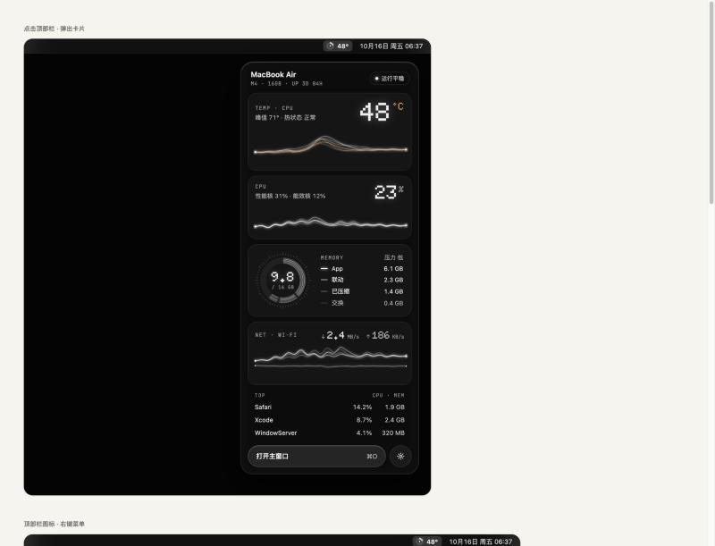

# Lucent

[English](README.md) · **简体中文**

轻量的 macOS 顶部栏监视器：温度、CPU、内存、网速，外加 AI 编程工具（Claude Code、Codex、OpenCode、Cursor）的用量看板。原生 Swift，Liquid Glass 界面，没有第三方依赖。



## 功能

- **顶部栏图标**三种样式：刻度环、能量线、双轨。平时是单色，CPU 温度超过你设的警戒值才变色。图标旁边可以显示温度、CPU、内存，或者什么都不显示。
- **卡片**（左键点图标）：温度、CPU、内存、网络四块，带实时丝线曲线；底部显示占用最高的进程或 AI 用量。每个模块都能在设置里关掉。
- **主窗口**（⌥ 点图标或 ⌘O）：概览、温度传感器、每个 CPU 核心、内存、网络、AI 用量、本机信息，左下角齿轮（⌘,）进设置。
- **AI 用量**：成本、请求数、token、缓存命中率、趋势、请求日志，按模型、项目、供应商分别统计，一年的日历热力图，还有本地估算的 5 小时窗口和燃烧速率。
- **多账号**：Claude Code 和 Codex 按配置目录区分账号（`CLAUDE_CONFIG_DIR` / `CODEX_HOME`）；Cursor 的其他账号可以「记住」到 macOS 钥匙串。只有一个账号时，界面不出现任何账号相关的东西。
- **个性化**：警戒温度、°C / °F、MB/s 或 Mbps、卡片显示哪些模块、图标样式和旁边的文字、动效开关、原生液态玻璃或磨砂材质。

## 环境要求

- macOS 26 或更新版本（推荐 Apple Silicon，Intel Mac 没测过）。
- 编译需要 Xcode 27（或带 macOS 26+ SDK 的工具链），旧版 Command Line Tools 解析不了包清单。

## 编译安装

```bash
git clone https://github.com/FlyLi666/Lucent.git
cd Lucent
./build.sh install      # 编译 → 拷到 /Applications → 启动
```

只运行 `./build.sh` 会生成 `build/Lucent.app`。装了多个 Xcode 时，先指定用哪个，例如 `export DEVELOPER_DIR=/Applications/Xcode.app/Contents/Developer`。

脚本会用找到的第一张「Apple Development」证书签名，这样钥匙串授权在更新后依然有效；没有证书就退回临时签名。这种情况下如果你用了「记住」的 Cursor 账号，每次更新后系统会再问一次是否允许访问钥匙串。

## 使用

- **左键**点顶部栏图标：打开卡片，点别处或按 Esc 收起。
- **右键**（或 Control+点击）：菜单，可以改刷新频率、图标样式、登录时启动。
- **⌥+点击**：直接打开主窗口。卡片里按 ⌘O 效果一样；⌘, 打开设置。

## AI 用量的数据从哪来

| 工具 | 数据来源 | 说明 |
|---|---|---|
| Claude Code（命令行 + 桌面版） | 本机 `~/.claude/projects/**/*.jsonl`（以及你另外加入的配置目录） | 金额按 LiteLLM 价目表折算成 API 等价价格，不是你的实际账单。**Lucent 不读任何 Claude 登录凭据**（Anthropic 条款不允许第三方收集会话令牌），所以官方额度只能点「打开用量页」去看。 |
| Codex（命令行 + 桌面版） | 本机 `~/.codex/sessions`（或 `$CODEX_HOME`）；日志已被删除的会话从 `state_5.sqlite` 补总数 | 金额按 API 等价价格折算。从数据库补回来的只有总数，分不出输入输出，也不算金额。 |
| OpenCode | 本机 `~/.local/share/opencode/opencode.db`，只读 | token 和金额都用 OpenCode 自己的记录。 |
| Cursor | Cursor 本机数据库里当前登录的令牌 → `cursor.com` 用量接口 | 当前登录的令牌只放在内存里；你「记住」的其他账号存在 macOS 钥匙串。请求只发往 `cursor.com`；只有「记住了、但当前没登录」的账号令牌过期时，才会连 `api2.cursor.sh` 刷新。不写任何 HTTP 缓存和 Cookie。 |

每天的汇总存在 `~/Library/Caches/local.lucent.monitor/`，只有数字、模型名和项目目录的最后一级名字，没有对话内容和凭据。所以即使工具自己的日志过期删掉了，热力图也会一直累积。

## 为什么轻

| 做法 | 效果 |
|---|---|
| 顶部栏图标画成一张小图，内容不变不重画 | 只有图标常驻时，没有任何 SwiftUI 视图在运行 |
| 卡片和主窗口关掉就释放整棵视图树 | 不开窗时内存只剩采样器本身 |
| 一个后台定时器（默认 2 秒，带 20% 宽限），屏幕休眠时停止采样 | 系统能合并唤醒，合盖零开销 |
| 只调 mach / sysctl / IOKit，不调用 `top`、`ps` | 每次采样微秒级 |
| 动效全部交给 Core Animation（系统渲染进程逐帧合成），本进程大约每秒只提交一次新数据 | 实测只有图标时约 0.3–0.7% CPU、16 MB；开着主窗口和动效约 6–8% |
| 窗口被挡住、低电量模式、系统「减弱动态效果」打开时，动效自动停 | |
| AI 日志按字节流式增量读，文件没变就跳过，超长行不解析，每轮限量 | 从零扫约 1 GB 日志，内存峰值约 170 MB，分几轮读完 |

## 说明

- 不使用沙盒（读 SMC 温度需要），所以不能上架 Mac App Store。
- 第一次启动会扫描一遍 SMC 键，之后从缓存读。
- 没有特权时，进程列表里看不到 root 的系统进程，这是正常的。

## 开发

调试版（`swift build`）支持几个参数：

- `--snapshots <目录>`：约 20 秒后把卡片、主窗口各分区、顶部栏图标渲染成 PNG 然后退出。加 `-usageFixture YES` 用示例数据填充 AI 页面，`-usage.tab heatmap` 之类可以指定页签。
- `--snapshots <目录> --hold N`：只开概览窗口 N 秒，方便用 `top -pid` 测占用。
- `--usage-dump [--cold]`：完整刷新一次用量并打印（不会打印任何凭据）后退出；`--cold` 用全新的临时缓存。
- 任何设置项都可以临时覆盖一次，例如 `-ui.tempUnit f -card.showNet NO`。

程序图标由 `scripts/make-icon.swift` 绘制，改完跑 `scripts/make-icon.sh` 重新生成 `Resources/AppIcon.icns`。

提交 PR 前请先读 [CONTRIBUTING.md](CONTRIBUTING.md)。

## 许可证

[MIT](LICENSE)。Lucent 包含改编自 AirStats、CodexBar、tokscale、ccusage、CC Switch、LiteLLM（均为 MIT）的代码和数据，并打包了 Doto 和 JetBrains Mono 字体（SIL OFL 1.1），详见 [THIRD_PARTY_NOTICES.md](THIRD_PARTY_NOTICES.md)。
